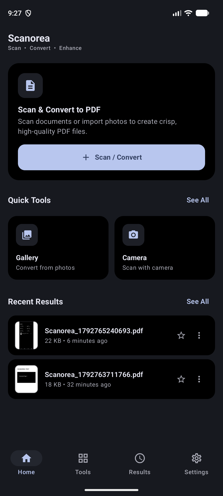
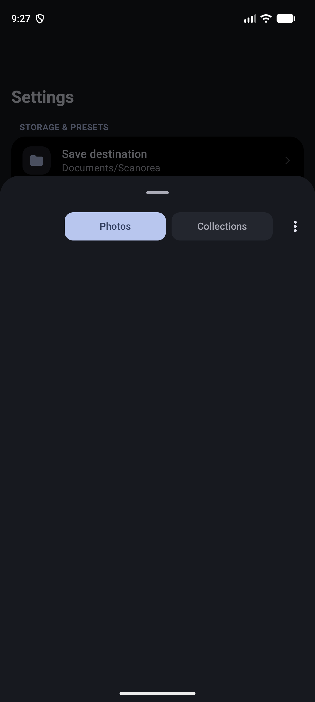
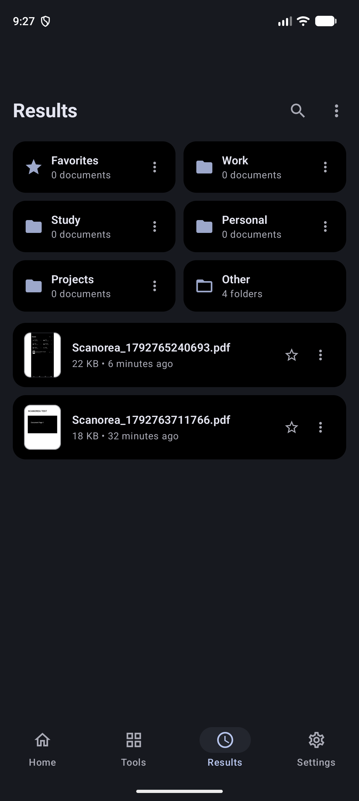
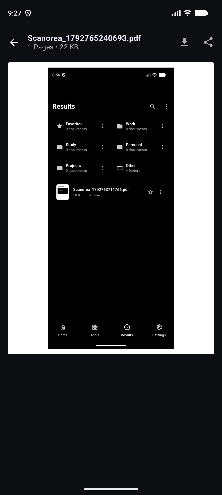

# Scanorea

Turn messy photos into clean, professional PDFs in seconds. Completely offline, private, and lightweight.

---

## What is Scanorea?

Scanorea is a modern Android document scanner and PDF maker built with Jetpack Compose. If you need to snap a few pages of notes, receipts, or contracts and turn them into a clean, easy-to-read PDF without dealing with intrusive ads, subscriptions, or cloud uploads, Scanorea is built for you.

Everything runs directly on your phone. No accounts. No tracking. Zero internet access required.

---

## Visual Tour

<p align="center">
  
  
  
  
</p>

---

## Why You Will Love It

### Total Privacy by Default
Scanorea does not even declare the internet permission. Your personal documents and scans never leave your device.

### Automatic Folder Organization
Whenever you convert a document, Scanorea automatically creates a Scanorea folder inside your device Documents directory (`Documents/Scanorea/`) on Android 10+ using Scoped Storage (zero permissions required). On all Android versions, you can also select any custom destination folder using the system folder picker.

### Smart Document Filters
Turn dark, shadowed paper photos into crisp black-and-white documents with one tap. Choose between B&W, Grayscale, Magic Color, or keep the original photo. Fine-tune brightness and contrast per page whenever you need extra clarity.

### Built-in Native PDF Viewer
Read and inspect your created PDFs right inside the app. Enjoy smooth pinch-to-zoom, instant page scrubbing with a dedicated fast scroller, and quick sharing.

### Featherweight and Fast
The entire app weighs under 3 MB thanks to strict R8 optimization. It launches instantly and runs smoothly without draining your battery or hogging storage.

---

## How It Works

1. **Pick or Snap**: Choose photos from your gallery or take new pictures with your camera.
2. **Tweak and Filter**: Crop, reorder pages, adjust contrast, and apply document filters.
3. **Save and Share**: Select your preferred paper size (A4, Letter) and compression quality, then hit Convert. Your PDF is instantly saved to `Documents/Scanorea` and ready to view or share.

---

## Download

Get the latest signed APK directly from the GitHub Releases page:

- [Download Latest APK](https://github.com/Leshoraa/Scanorea/releases/latest)

Compatible with Android 7.0 (API 24) and newer, with full support for Android 12+ Material You dynamic theming.

---

## Building from Source

If you want to build the project yourself using Android Studio or Gradle:

```bash
# Clone the repository
git clone https://github.com/Leshoraa/Scanorea.git
cd Scanorea

# Run unit tests
./gradlew testDebugUnitTest

# Build debug APK
./gradlew assembleDebug

# Build optimized release APK
./gradlew assembleRelease
```
